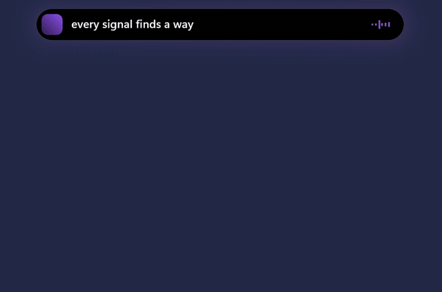
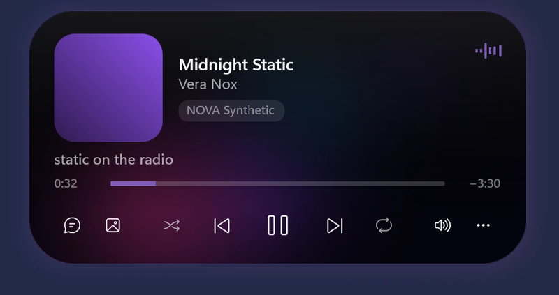
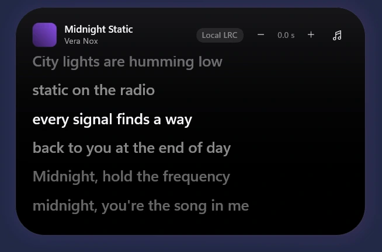
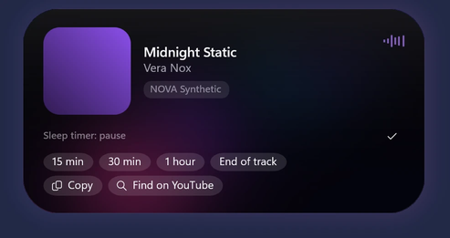
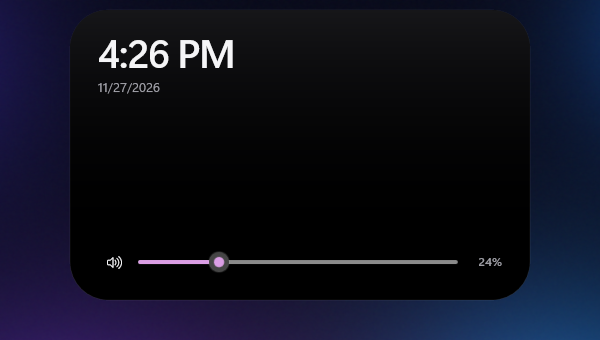

<p align="center">
  
</p>

<h1 align="center">NOVA Island</h1>

<p align="center">
  <b>A Dynamic Island–style capsule for Windows 11.</b><br>
  Your music, synced lyrics, notifications and a system center, right at the top of the screen. Free.
</p>

<p align="center">
  <a href="https://github.com/ZawkyQ/nova-island-releases/releases/latest"><b>⬇ Download for Windows 11</b></a>
  &nbsp;·&nbsp; <a href="https://zawkyq.github.io/nova-island-releases/">Website</a>
  &nbsp;·&nbsp; <a href="README.ru.md">Русский</a>
</p>

---

## What it does

Real screenshots of NOVA Island; the track and the lyrics are made up for the demo.

| | |
|---|---|
|  | **A player for any app Windows sees:** Spotify, Yandex Music, browsers and more. Drag to seek, shuffle and repeat (where the player supports them), the player's own volume (or the Windows volume if the player has no sound of its own), and an equalizer that follows the real sound. |
|  | **Synced lyrics** from your own `.lrc` files or LRCLIB. Lines move only by real timestamps, never guessed. A lyric line can also sit right in the small capsule. |
|  | **More:** a sleep timer (15, 30, 60 min or end of track), copy the title, find it on YouTube, switch between apps that are playing. |
|  | **System center and Windows notifications:** quiet hours and flood protection; notification text is never stored. |

Also inside:
- **GIFs and videos** as the player's background, **9 themes** plus your own, and **profiles** you can send to a friend as one file (with GIFs and videos up to 32 MB each).
- **Offline voice assistant** (whisper.cpp on your PC, Russian and English) and **hotkeys**.
- **Games:** in full-screen apps the island fades back or hides, as you choose; a hotkey or your voice still brings it up.
- **Discord status** like Spotify's: cover, progress, player and buttons.
- **Gestures on the small capsule:** scroll for volume, Shift+scroll to skip forward or back, middle-click to play or pause.
- **Light:** in our earlier tests it used about 0.01–0.04% of the CPU at idle.
- English and Russian interface.

## Install

1. Download the single file **`NovaIsland-…-Setup.zip`** from the [latest release](https://github.com/ZawkyQ/nova-island-releases/releases/latest).
2. Right-click it → **Extract All**, then run **`Install.cmd`** in the extracted folder.
3. Windows asks for administrator rights **once** (the prompt says "Windows PowerShell"), to trust the NOVA Island certificate. Click **Yes**. NOVA installs and starts; then press any key to close the black window.

If Windows shows **"Windows protected your PC"**, click **More info → Run anyway**, but only for the file you downloaded from this page (check it first, see below).

On first start NOVA turns on start with Windows and sets free hotkeys (you can change both in Settings), and Windows asks once for the microphone and notifications.

Requires **Windows 11, x64**. .NET, the Windows App Runtime and the Visual C++ runtime the voice assistant needs are inside the package. Windows 10 is not supported.

**Updates** come inside the app: NOVA tells you when a new version is out. Click **Settings → About → Updates → Download and install**, then confirm in the Windows installer window that opens.

### Why does Windows warn me?

NOVA Island is signed with its own certificate (`CN=NovaIsland Dev`), not a paid one, so Windows does not know the publisher yet and may say so. `Install.cmd` runs `Install.ps1` (you can read it) once, with PowerShell's script policy relaxed for that run only. The script:

- adds that certificate to **Local Machine → Trusted People** (this is the admin prompt), so Windows can install the signed package;
- removes an old developer build of NOVA, if there is one (your settings stay);
- installs the `.msix` package next to it (closing a running NOVA first) and starts NOVA.

It does not turn off SmartScreen or your antivirus, and there is no need to. Certificate thumbprint: `784A44CC9743B80100C95C3852142647B53DD8B3`.

**Check the download:** in PowerShell, in your Downloads folder, run `Get-FileHash .\NovaIsland-*-Setup.zip` and compare the result with `SHA256SUMS.txt` in the same release (upper or lower case does not matter).

Opened the `.msix` directly and the **Install** button is grey? Windows does not trust the certificate yet: run `Install.cmd` instead.

## What NOVA sends to the internet

| What | Where | When | Turn off |
|---|---|---|---|
| Artist, title, album and length of the track (or the words you type in the manual search), to find lyrics | lrclib.net | A track without a local `.lrc` or saved lyrics starts, or you search by hand | Settings → Lyrics |
| The voice model, once (~57 MB; ~31 MB if you pick Tiny) | huggingface.co and its file servers | While voice is on and the model is not on your PC yet (normally right after the first start) | Settings → Voice |
| Update check (and the download count shown in About) | api.github.com, this repository | About a minute after start if "Check at start" is on (it is by default), and when you click "Check now" | Settings → About → Updates |
| The new version | github.com and its download servers, this repository | Only when you click "Download and install" | — |
| Track, artist, album, player, progress, cover and buttons, shown in your Discord status to your friends and members of your servers | Discord, through the Discord app on your PC | While Discord is running | Settings → Discord |
| Artist and title, to find a cover for the Discord status | itunes.apple.com, api.deezer.com | Only while connected to Discord | Settings → Discord |
| Artist and title of the playing track, as a YouTube search | youtube.com, in your browser | Only when you click "Find on YouTube" | — |

Each of these requests carries the app's name and version and, like any connection, your IP address. Other links in the app (What's new, the Discord Developer Portal) open in your browser only when you click them.

NOVA itself has no ads, accounts, analytics or telemetry. Windows and the bundled Windows App Runtime may send Microsoft diagnostic data, as your Windows privacy settings allow.

Never sent by NOVA:
- **Notification text:** shown on the island, never stored.
- **Your voice:** the microphone opens only while the island is listening to you, and speech is recognized on your PC.
- **Sound for the equalizer:** analysed in memory and dropped at once.
- **GIFs, themes, settings and logs.** A profile you export holds all your settings (including folder paths and app names) and your GIFs; NOVA never sends it, you choose who gets it.

## Uninstall

**Settings → Apps → Installed apps → NOVA Island → Uninstall.** To also remove the certificate, run this in an administrator PowerShell:

```powershell
Remove-Item Cert:\LocalMachine\TrustedPeople\784A44CC9743B80100C95C3852142647B53DD8B3
```

Your settings, GIF library, logs and the voice model stay in `%LOCALAPPDATA%\NovaIsland`; delete that folder to remove them too.

## Known limitations

- Over exclusive full-screen apps, Windows may not show the island.
- Shuffle and repeat work only with players that report them to Windows (browsers do not). Windows gives apps no likes or queue.
- Battery level is shown only for Bluetooth devices that report it to Windows.
- The voice assistant needs a CPU with AVX2: almost every recent PC, but not some Celeron and Pentium Silver models.
- Because the certificate is self-signed, SmartScreen may warn about an unknown publisher.

## Feedback

Found a bug or want a feature? [Open an issue](https://github.com/ZawkyQ/nova-island-releases/issues/new) (needs a GitHub account), or write in [Telegram](https://t.me/killuez) (in Russian).

This repository holds the signed release packages and this website; the app's code is closed. Third-party licenses are inside every Setup.zip (`THIRD-PARTY-NOTICES.txt` and the `licenses` folder). NOVA Island is not affiliated with Apple; Dynamic Island is a trademark of Apple Inc.
