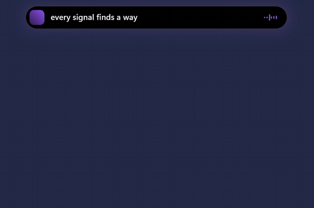
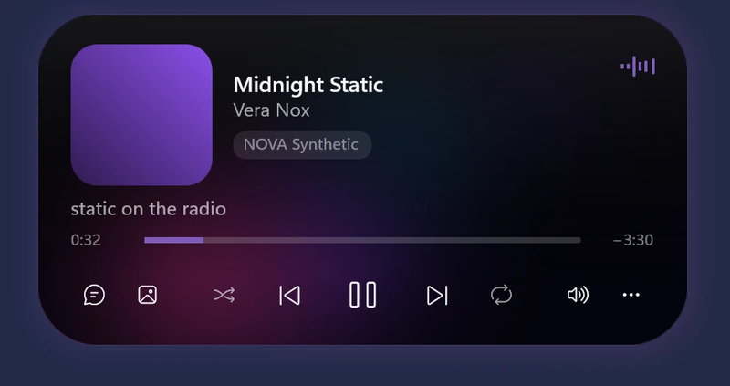
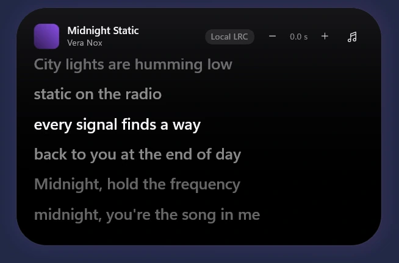
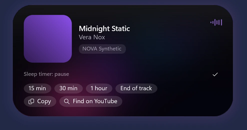
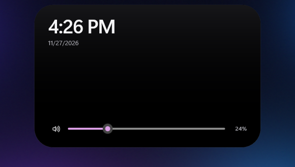

<p align="center">
  
</p>

<h1 align="center">NOVA Island</h1>

<p align="center">
  <b>Остров в стиле Dynamic Island для Windows 11.</b><br>
  Музыка, текст песни, уведомления и системный центр в капсуле сверху экрана. Бесплатно.
</p>

<p align="center">
  <a href="https://github.com/ZawkyQ/nova-island-releases/releases/latest"><b>⬇ Скачать для Windows 11</b></a>
  &nbsp;·&nbsp; <a href="https://zawkyq.github.io/nova-island-releases/?lang=ru">Сайт</a>
  &nbsp;·&nbsp; <a href="README.md">English</a>
</p>

---

## Что умеет

Настоящие снимки NOVA Island; трек и текст придуманы для показа.

| | |
|---|---|
|  | **Плеер для любого приложения, которое видит Windows:** Spotify, Яндекс Музыка, браузеры и другие. Перемотка перетаскиванием, перемешивание и повтор (если плеер их даёт), громкость самого плеера (или громкость Windows, если у плеера нет своего звука) и эквалайзер по настоящему звуку. |
|  | **Синхронный текст песни** из ваших файлов `.lrc` или с LRCLIB. Строки сменяются только по настоящим временным меткам, ничего не угадывается. Строку текста можно показывать прямо в маленькой капсуле. |
|  | **«Ещё»:** таймер сна (15, 30, 60 минут или до конца трека), скопировать название, найти на YouTube, переключиться между играющими приложениями. |
|  | **Системный центр и уведомления Windows:** тихие часы и защита от потока уведомлений; их текст нигде не сохраняется. |

Ещё внутри:
- **Гифки и видео** фоном плеера, **9 тем** и свои, **профили**: свой остров можно скинуть другу одним файлом вместе с гифками и видео до 32 МБ.
- **Голосовой ассистент без интернета** (whisper.cpp на вашем ПК, русский и английский) и **горячие клавиши**.
- **Игры:** в полноэкранных приложениях остров приглушается или прячется, как выберете; по сочетанию клавиш или голосу он всё равно появится.
- **Статус в Discord**, как у Spotify: обложка, время, плеер и кнопки.
- **Жесты на маленькой капсуле:** колёсико — громкость, Shift+колёсико — следующий или предыдущий трек, нажатие колёсика — пауза и продолжение.
- **Не грузит ПК:** в наших прежних замерах в покое около 0,01–0,04 % процессора.
- Интерфейс на русском и английском.

## Установка

1. Скачайте один файл **`NovaIsland-…-Setup.zip`** из [последнего выпуска](https://github.com/ZawkyQ/nova-island-releases/releases/latest).
2. Правой кнопкой → **«Извлечь все»**, затем запустите **`Install.cmd`** из распакованной папки.
3. Windows **один раз** попросит права администратора (в окне будет написано «Windows PowerShell»), чтобы доверять сертификату NOVA Island. Нажмите **«Да»**. NOVA установится и запустится; потом нажмите любую клавишу, чтобы закрыть чёрное окно.

Если Windows покажет **«Система Windows защитила ваш компьютер»**, нажмите **«Подробнее» → «Выполнить в любом случае»**, но только для файла, скачанного с этой страницы (сначала проверьте его, см. ниже).

При первом запуске NOVA включает автозапуск вместе с Windows и назначает свободные горячие клавиши (и то и другое меняется в настройках), а Windows один раз спросит про микрофон и уведомления.

Нужна **Windows 11, x64**. .NET, Windows App Runtime и библиотеки Visual C++ для голосового ассистента уже внутри пакета. Windows 10 не поддерживается.

**Обновления** приходят внутри программы: NOVA сама скажет о новой версии. Нажмите **«Настройки → О программе → Обновления → Скачать и установить»** и подтвердите установку в открывшемся окне Windows.

### Почему Windows предупреждает?

NOVA Island подписана своим сертификатом (`CN=NovaIsland Dev`), а не платным, поэтому Windows пока не знает издателя и может об этом написать. `Install.cmd` один раз запускает `Install.ps1` (его можно прочитать), ослабив политику скриптов PowerShell только на этот запуск. Скрипт:

- добавляет сертификат в **«Локальный компьютер → Доверенные лица»** (это и есть запрос прав администратора), чтобы Windows могла поставить подписанный пакет;
- удаляет старую сборку разработчика NOVA, если она есть (настройки остаются);
- ставит пакет `.msix`, который лежит рядом (запущенную NOVA сначала закрывает), и запускает NOVA.

Он не отключает SmartScreen и антивирус, и вам их отключать не нужно. Отпечаток сертификата: `784A44CC9743B80100C95C3852142647B53DD8B3`.

**Проверить файл:** в PowerShell, в папке «Загрузки», выполните `Get-FileHash .\NovaIsland-*-Setup.zip` и сравните результат с `SHA256SUMS.txt` в том же выпуске (регистр букв не важен).

Открыли `.msix` напрямую, и кнопка **«Установить»** серая? Windows ещё не доверяет сертификату: запустите `Install.cmd`.

## Что NOVA отправляет в интернет

| Что | Куда | Когда | Где выключить |
|---|---|---|---|
| Исполнитель, название, альбом и длина трека (или слова, которые вы ввели в ручном поиске), чтобы найти текст | lrclib.net | Начался трек без локального файла `.lrc` и без сохранённого текста, или вы ищете вручную | Настройки → Тексты |
| Модель голоса, один раз (~57 МБ; ~31 МБ, если выбрать Tiny) | huggingface.co и его файловые серверы | Пока голос включён, а модели ещё нет на ПК (обычно сразу после первого запуска) | Настройки → Голос |
| Проверка обновлений (и счётчик скачиваний в «О программе») | api.github.com, этот репозиторий | Через минуту после запуска, если включено «Проверять при запуске» (включено по умолчанию), и по кнопке «Проверить сейчас» | Настройки → О программе → Обновления |
| Новая версия | github.com и его серверы загрузки, этот репозиторий | Только по нажатию «Скачать и установить» | — |
| Трек, исполнитель, альбом, плеер, время, обложка и кнопки — их видят в вашем статусе Discord друзья и участники ваших серверов | Discord, через приложение Discord на вашем ПК | Пока запущен Discord | Настройки → Discord |
| Исполнитель и название, чтобы найти обложку для статуса Discord | itunes.apple.com, api.deezer.com | Только пока есть связь с Discord | Настройки → Discord |
| Исполнитель и название играющего трека как поиск на YouTube | youtube.com в браузере | Только по нажатию «Найти на YouTube» | — |

В каждом из этих запросов есть название и версия программы и, как при любом подключении, ваш IP-адрес. Другие ссылки в программе («Что нового», портал разработчиков Discord) открываются в браузере только по нажатию.

В самой NOVA нет рекламы, аккаунтов, аналитики и телеметрии. Windows и встроенный Windows App Runtime могут отправлять Microsoft диагностические данные, насколько это разрешают настройки конфиденциальности Windows.

NOVA никуда не отправляет:
- **Текст уведомлений:** показывается на острове и нигде не сохраняется.
- **Ваш голос:** микрофон включается, только пока остров вас слушает, и речь распознаётся на вашем ПК.
- **Звук для эквалайзера:** разбирается в памяти и сразу забывается.
- **Гифки, темы, настройки и журналы.** В экспортированном профиле лежат все ваши настройки (в том числе пути к папкам и названия приложений) и гифки; NOVA его никуда не отправляет, кому его дать, решаете вы.

## Удаление

**«Параметры → Приложения → Установленные приложения → NOVA Island → Удалить».** Чтобы удалить и сертификат, выполните в PowerShell от имени администратора:

```powershell
Remove-Item Cert:\LocalMachine\TrustedPeople\784A44CC9743B80100C95C3852142647B53DD8B3
```

Настройки, гифки, журналы и модель голоса остаются в папке `%LOCALAPPDATA%\NovaIsland`; удалите её, чтобы стереть и их.

## Известные ограничения

- Поверх эксклюзивного полноэкранного режима Windows может не показать остров.
- Перемешивание и повтор работают только у плееров, которые сообщают их Windows (браузеры не сообщают). Лайков и очереди Windows приложениям не даёт.
- Заряд показывается только у Bluetooth-устройств, которые сообщают его Windows.
- Голосовому ассистенту нужен процессор с AVX2: это почти все ПК последних лет, но не некоторые Celeron и Pentium Silver.
- Сертификат самоподписанный, поэтому SmartScreen может предупредить о неизвестном издателе.

## Обратная связь

Нашли баг или хотите функцию? [Напишите в Issues](https://github.com/ZawkyQ/nova-island-releases/issues/new) (нужен аккаунт GitHub) или в [Telegram](https://t.me/killuez).

Здесь лежат подписанные пакеты выпусков и этот сайт; код программы закрыт. Лицензии сторонних компонентов — внутри каждого Setup.zip (`THIRD-PARTY-NOTICES.txt` и папка `licenses`). NOVA Island не связана с Apple; Dynamic Island — товарный знак Apple Inc.
